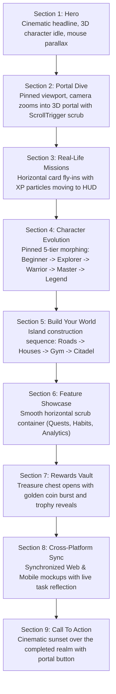

# LIFEVERSE — Animation & 3D Visual System

## 1. Overview

LIFEVERSE combines cinematic storytelling, dynamic 3D visualizations, and tactile micro-interactions to create an immersive RPG atmosphere while maintaining high frame rates across low-end and high-end hardware.

The visual stack consists of:
1. **Web:** Three.js + React Three Fiber (R3F) + React Three Drei for 3D viewports.
2. **Web Scroll & Storytelling:** GSAP 3 + ScrollTrigger for pinned multi-stage transitions.
3. **Web Micro-Interactions:** Motion for React (framer-motion API) + Canvas Confetti.
4. **Android Mobile:** React Native Reanimated 3 + Gesture Handler + Skia Isometric canvas.

---

## 2. Web 3D Canvases (`apps/web/src/components/three/`)

### 2.1 The Mystic Portal (`PortalCanvas.jsx`)
Featured in Landing Page Sections 1 & 2 ("Enter the Universe").
- **Technique:** Custom procedural shader geometry with oscillating rings and particle swarms.
- **Lighting:** Dual point lights (`#8B5CF6` electric violet and `#38BDF8` neon cyan) rotating along an elliptical orbit.
- **Camera Interpolation:** The camera distance scrubs with the user's scroll position via GSAP ScrollTrigger:
  - Scroll 0%: Camera at `[0, 0, 7]` (outer view of the dimensional rift).
  - Scroll 100%: Camera dives through the portal center into `[0, 0, -2]` with bloom intensification.
- **Mouse Responsiveness:** Gentle camera parallax tilting using Lerp on mouse pointer coordinates:
  $$\vec{C}_{\text{rot}} = \text{lerp}(\vec{C}_{\text{rot}}, \vec{P}_{\text{mouse}} \times 0.2, 0.05)$$

### 2.2 3D Character Evolution & Customizer (`Avatar3DPreview.jsx`)
Used in Landing Section 4 and the interactive Avatar Customizer page (`/avatar`).
- **Structure:**
  - Procedural humanoid avatar composed of stylized geometric limbs with PBR (Physically Based Rendering) standard materials.
  - Smooth floating idle animation driven by R3F `useFrame((state) => ...)`:
    $$y(t) = y_0 + \sin(t \times 2.0) \times 0.1$$
  - Real-time reactive equipment mounting: Helmet/Crown, Pauldrons/Armor, Wings, and Aura particles update immediately upon equipping items from inventory.
  - OrbitControls with bounded azimuthal angles and zoom damping (`enableDamping: true`, `dampingFactor: 0.05`).

### 2.3 3D Floating World Viewer (`World3DViewer.jsx`)
Used in Landing Section 5 and the player's personal Realm page (`/world`).
- **Environment:** Low-poly floating celestial island with procedural grass, crystal trees, and cloud layers.
- **Interactive Grid System:**
  - 16x16 isometric terrain grid with raycasting selection for building placement.
  - Buildings render as stylized structures: Houses, Libraries, Gyms, Tech Centers, and Citadel Spires with glowing window emissive maps.
  - On hover: Building elevations bounce slightly with dynamic outline highlights.
  - Day/Night lighting cycle driven by user preference or real-world local time.

---

## 3. GSAP ScrollTrigger Cinematic Sequencing (`LandingPage.jsx`)

The landing page features 9 continuous, scroll-driven acts:



### GSAP Lifecycle & Memory Safety
To prevent memory leaks and broken scroll scrubbers across client-side page navigation:
```javascript
useEffect(() => {
  const ctx = gsap.context(() => {
    // All ScrollTrigger timelines declared inside context
    gsap.timeline({
      scrollTrigger: {
        trigger: portalRef.current,
        start: 'top top',
        end: '+=150%',
        scrub: 1,
        pin: true
      }
    }).to(camera.position, { z: -1, ease: 'power2.inOut' });
  });

  return () => ctx.revert(); // Automatically cleans up triggers and tweens on unmount
}, []);
```

---

## 4. Mobile Animation Engine (React Native)

### 4.1 Reanimated 3 Micro-Interactions
- **Quest Completion:** Checking off a quest triggers a spring bounce using `withSpring({ damping: 12, stiffness: 150 })` coupled with tactile device feedback via `expo-haptics`.
- **Level-Up Modal:** Pop-up banner with radial burst animation scaling from 0 to 1.15 before settling.

### 4.2 Isometric Island Canvas (`IsometricWorldView.jsx`)
- Built for high performance on Android mobile without demanding heavy WebGL context.
- Uses 2D isometric projection transformations:
  $$x_{\text{screen}} = (x - y) \times \frac{W_{\text{tile}}}{2}$$
  $$y_{\text{screen}} = (x + y) \times \frac{H_{\text{tile}}}{2}$$
- Buildings appear as vibrant isometric vectors with real-time level badges.

---

## 5. Accessibility & Reduced Motion

- **`prefers-reduced-motion` Support:**
  - Web components detect user preferences via `@media (prefers-reduced-motion: reduce)`.
  - When enabled, GSAP scroll scrubbers transition to static stacked layouts, Three.js camera zooms are replaced with fade transitions, and particle emission is disabled.
- **Hardware Acceleration:**
  - All CSS transitions utilize GPU-accelerated properties (`transform`, `opacity`, `filter`).
  - WebGL context is throttled on low-power devices with dynamic pixel ratio clamping:
    `gl={{ powerPreference: "high-performance", pixelRatio: Math.min(window.devicePixelRatio, 2) }}`
