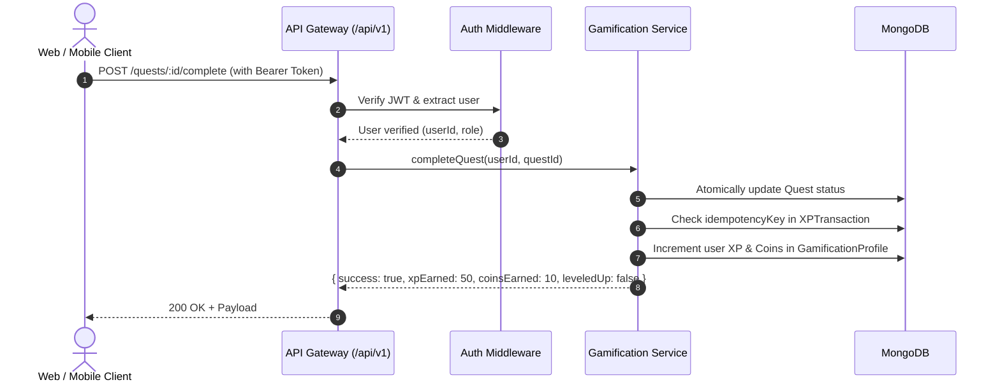

# LIFEVERSE — REST & Real-Time API Reference

## 1. Overview & Base URL

- **Base URL:** `http://localhost:5000/api/v1`
- **Interactive Swagger/OpenAPI Docs:** `http://localhost:5000/api/docs`
- **Content-Type:** `application/json`
- **Authentication:** Bearer token in `Authorization: Bearer <JWT_ACCESS_TOKEN>` header (or HTTP-only refresh cookies for session rotation).



---

## 2. API Endpoints

### 2.1 Authentication & Profile (`/api/v1/auth`)

| Method | Endpoint | Auth | Description |
|:---|:---|:---|:---|
| `POST` | `/auth/register` | Public | Register a new user (`email`, `username`, `password`) |
| `POST` | `/auth/login` | Public | Login with `email`/`username` & `password`. Returns user & access token; sets refresh cookie |
| `POST` | `/auth/admin-login` | Public | Administrator login endpoint (enforces `role === 'admin'`) |
| `POST` | `/auth/refresh-token` | Cookie / Body | Rotates refresh token and returns fresh access token |
| `POST` | `/auth/logout` | User | Revokes the current device refresh session |
| `POST` | `/auth/logout-all` | User | Revokes all active sessions across all devices |
| `GET` | `/auth/me` | User | Get authenticated user identity, role, and profile |
| `PUT` | `/auth/profile` | User | Update display name, bio, preferences, timezone |
| `POST` | `/auth/change-password` | User | Change user password (`oldPassword`, `newPassword`) |

---

### 2.2 Gamification & Economy (`/api/v1/gamification`)

| Method | Endpoint | Auth | Description |
|:---|:---|:---|:---|
| `GET` | `/gamification/profile` | User | Fetch full gamification state (XP, Level, Coins, Streaks, Rank) |
| `GET` | `/gamification/transactions` | User | Paginated audit log of XP and Coin grants |
| `GET` | `/gamification/leaderboard` | User | Top players ranked by XP, streak, or quests completed |

---

### 2.3 Quests & Missions (`/api/v1/quests`)

| Method | Endpoint | Auth | Description |
|:---|:---|:---|:---|
| `GET` | `/quests` | User | Query quests with filters (`status`, `category`, `difficulty`, `search`) |
| `POST` | `/quests` | User | Create a new quest (`title`, `category`, `difficulty`, `dueDate`) |
| `GET` | `/quests/:id` | User | Retrieve single quest details |
| `PUT` | `/quests/:id` | User | Update title, description, due date, status |
| `POST` | `/quests/:id/complete` | User | Complete quest, trigger server-authoritative XP and coin rewards |
| `DELETE` | `/quests/:id` | User | Archive / delete quest |

---

### 2.4 Habits & Streaks (`/api/v1/habits`)

| Method | Endpoint | Auth | Description |
|:---|:---|:---|:---|
| `GET` | `/habits` | User | List all active habits with current streak and today's status |
| `POST` | `/habits` | User | Create habit (`title`, `frequency`, `targetPerPeriod`, `color`) |
| `POST` | `/habits/:id/check-in` | User | Check in habit for today. Evaluates streak and awards XP |
| `GET` | `/habits/:id/history` | User | Get 28-day / 90-day check-in heatmap matrix |
| `DELETE` | `/habits/:id` | User | Delete habit and check-in history |

---

### 2.5 Goals, Fitness & Learning

| Method | Endpoint | Auth | Description |
|:---|:---|:---|:---|
| `GET` | `/goals` | User | List long-term goals with milestones and progress |
| `POST` | `/goals` | User | Create goal with milestones |
| `POST` | `/goals/:id/milestones/:mId/toggle` | User | Mark milestone complete, recalculate % |
| `POST` | `/fitness/workouts` | User | Log a workout session (`type`, `durationMinutes`, `calories`) |
| `GET` | `/fitness/workouts` | User | List workout history and personal records |
| `GET` | `/learning/roadmaps` | User | List active learning roadmaps and study sessions |
| `POST` | `/learning/roadmaps` | User | Create custom learning syllabus or roadmap |
| `POST` | `/learning/sessions` | User | Log study session minutes with XP boost |

---

### 2.6 Virtual World, Buildings & Avatar

| Method | Endpoint | Auth | Description |
|:---|:---|:---|:---|
| `GET` | `/world` | User | Fetch active 3D island state, grid placements, and bonuses |
| `POST` | `/world/place-building` | User | Place an owned building at coordinates `(x, y, z)` |
| `POST` | `/world/move-building` | User | Move placed building to new coordinate |
| `GET` | `/avatar` | User | Fetch avatar 3D customization config (head, body, armor, skin) |
| `PUT` | `/avatar` | User | Update equipped avatar cosmetics |
| `GET` | `/marketplace/catalog` | User | Browse buildings, skins, and boosters available for purchase |
| `POST` | `/marketplace/buy` | User | Deduct coins and add building/item to user's inventory |

---

### 2.7 Challenges, Community & Friends

| Method | Endpoint | Auth | Description |
|:---|:---|:---|:---|
| `GET` | `/challenges` | User | View active global and community challenges |
| `POST` | `/challenges/:id/join` | User | Join a community challenge |
| `GET` | `/community/posts` | User | Feed of player achievements, shared milestones, and posts |
| `POST` | `/community/posts` | User | Create a community post |
| `POST` | `/community/posts/:id/like` | User | Like a post |
| `POST` | `/community/posts/:id/comments` | User | Comment on a community post |
| `GET` | `/friends` | User | List friends and pending friendship requests |
| `POST` | `/friends/request` | User | Send a friend request by username |
| `POST` | `/friends/accept/:id` | User | Accept incoming friend request |

---

### 2.8 Administrative Control (`/api/v1/admin`)

*All routes require role `admin`.*

| Method | Endpoint | Auth | Description |
|:---|:---|:---|:---|
| `GET` | `/admin/analytics` | Admin | Aggregate stats: daily active users, total XP awarded, quest completions |
| `GET` | `/admin/users` | Admin | Search, filter, and list users with roles and status |
| `PUT` | `/admin/users/:id/status` | Admin | Suspend, ban, or restore user account |
| `GET` | `/admin/reports` | Admin | Review reported community posts and users |
| `PUT` | `/admin/reports/:id/resolve`| Admin | Dismiss or take disciplinary action on report |
| `GET` | `/admin/audit-logs` | Admin | Paginated security and administrative audit trail |
| `GET` | `/admin/settings` | Admin | Retrieve dynamic system settings & XP multipliers |
| `PUT` | `/admin/settings` | Admin | Update system XP rate, maintenance mode, or feature flags |

---

## 3. Real-Time WebSocket Events (Socket.IO)

Clients connect to `ws://localhost:5000` with auth payload:
`{ auth: { token: "<ACCESS_TOKEN>" } }`

### Incoming Client Events
- `join:challenge` — Subscribes to real-time challenge leaderboard updates.
- `typing:comment` — Broadcasts typing indicators in community threads.

### Outgoing Server Events
- `GAMIFICATION_UPDATE` — Dispatched on level-up, XP award, or coin increment.
  ```json
  {
    "totalXp": 450,
    "level": 3,
    "coins": 85,
    "leveledUp": true,
    "newRank": "Novice"
  }
  ```
- `NOTIFICATION_RECEIVED` — Real-time in-app notification alert.
- `WORLD_SYNC` — Notifies other connected sessions of building placement changes.
- `CHALLENGE_PROGRESS` — Real-time community progress updates.
