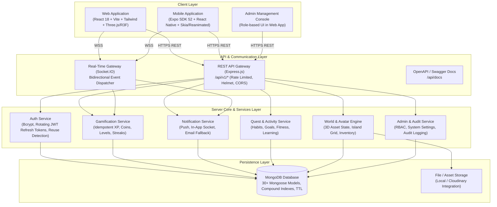

# LIFEVERSE — Architecture & System Design Documentation

## 1. System Overview

**LIFEVERSE** ("Turn Your Real Life Into an Adventure") is an enterprise-grade gamified productivity and lifestyle ecosystem. It transforms everyday tasks, habits, learning milestones, and workouts into a persistent, immersive role-playing game (RPG) across Web and Android Mobile clients.

The platform relies on a **server-authoritative gamification engine** to guarantee data integrity, preventing client-side score manipulation, duplicate rewards, or forged achievements.



---

## 2. Monorepo Structure

The project is structured as an npm workspaces monorepo:

```text
LIFEVERSE/
├── package.json               # Root monorepo workspace configuration
├── packages/
│   ├── design-tokens/         # Unified color palettes, glassmorphism, typography, shadows
│   ├── shared/                # Universal business logic (calculateLevelFromTotalXp, streak logic, constants)
│   └── api-client/            # Cross-platform Axios instance with auto-refresh token interceptor
├── server/                    # Node.js/Express REST API + Socket.IO server + Mongoose models
│   ├── src/
│   │   ├── config/            # DB, environment, Swagger, email configs
│   │   ├── constants/         # Roles, gamification constants, error codes
│   │   ├── controllers/       # Modular controllers (auth, quests, habits, admin, etc.)
│   │   ├── middleware/        # auth, rbac, rateLimiter, validator, errorHandler
│   │   ├── models/            # 28 Mongoose models with validation & indexes
│   │   ├── routes/            # Express v1 routers
│   │   ├── seeds/             # Database seed script for initial admin, items, buildings
│   │   ├── services/          # Pure server business logic (Gamification, Auth, etc.)
│   │   ├── sockets/           # Socket.IO connection & event management
│   │   └── utils/             # Crypto, tokens, logger, response helpers
│   └── tests/                 # Vitest backend integration test suite
├── apps/
│   ├── web/                   # React 18 + Vite SPA with Three.js & Tailwind CSS
│   │   ├── src/
│   │   │   ├── components/    # 3D Canvases (Portal, World, Avatar), UI primitives
│   │   │   ├── pages/         # 25+ cinematic & dashboard pages (Landing, Quests, Admin, etc.)
│   │   │   ├── stores/        # Zustand client state (authStore, gamificationStore, uiStore)
│   │   │   └── lib/           # Socket client, formatters, query client
│   │   └── tailwind.config.js # Extended with design-tokens
│   └── mobile/                # Expo SDK 52 React Native Android app
│       ├── app/               # Expo Router directory (tabs, auth, modal screens)
│       ├── components/        # Mobile UI cards, isometric world, buttons
│       └── stores/            # SecureStore-backed auth & state management
└── docs/                      # Architectural, database, API, and deployment documentation
```

---

## 3. Server-Authoritative Gamification Logic

To prevent cheating and maintain high player engagement, all XP calculations, level-ups, coin awards, and streak evaluations take place exclusively on the backend:

### 3.1 Idempotency Key Engine
Every XP or Coin grant requires an `idempotencyKey` formatted as `<category>:<action>:<referenceId>:<date/hash>`.
- The `GamificationService.awardXP()` and `awardCoins()` methods search `XPTransaction` / `CoinTransaction` before issuing any balance increment.
- If a transaction matching the idempotency key exists, the service returns the existing balance without doubling rewards.

### 3.2 Quadratic Level Formula
Character progression scales with higher levels using the formula:
$$\text{TotalXP}(\text{level}) = \text{floor}\left(100 \times (\text{level} - 1)^{1.6}\right)$$

| Level Range | Player Rank | Visual Theme | Unlockables |
|:---|:---|:---|:---|
| 1 – 4 | **Novice / Beginner** | Slate / Dim Neon | Basic Island, Common Tasks |
| 5 – 9 | **Explorer** | Emerald Cyan | Habit Streaks, Workouts, First House |
| 10 – 19 | **Warrior** | Electric Blue | Custom Avatar Armor, Library, Roadmaps |
| 20 – 34 | **Master** | Mystic Purple | Tech Center, Guild Challenges, Trophies |
| 35+ | **Legend** | Radiant Gold | Sky Citadel, World Portal, Global Badges |

### 3.3 Streak Evaluation Logic
Habit streaks track consecutive completion days with time-zone sensitivity:
- If a habit was checked in yesterday $\to$ `currentStreak = currentStreak + 1`.
- If checked in today $\to$ streak maintains.
- If more than 1 calendar day was missed $\to$ `currentStreak` resets to 1 (unless the user consumes a "Streak Freeze" item).
- `longestStreak` is updated automatically when `currentStreak > longestStreak`.

---

## 4. Cross-Platform Synchronization & Real-Time Events

1. **State Hydration:** When a user logs in on Web or Mobile, the client fetches the aggregated `GamificationProfile`, active `VirtualWorld`, and pending `Notifications`.
2. **WebSocket Synchronization:**
   - Both web and mobile clients connect to Socket.IO using an authenticated JWT handshake.
   - Rooms are partitioned per user (`user:<userId>`) and per community challenge (`challenge:<challengeId>`).
   - When a quest is completed on Mobile, the backend awards XP, emits a `GAMIFICATION_UPDATE` event, and the Web dashboard increments the progress bar and fires confetti in real time.
3. **Optimistic Updates with Rollback:**
   - The UI optimistically checks off quests and updates task state immediately.
   - If the API rejects the request (e.g., unauthorized or validation failure), TanStack Query invalidates cache and rolls back client state.

---

## 5. Security & Authentication Architecture

- **Token Strategy:**
  - **Access Token:** Short-lived JWT (15-minute expiration) signed with RSA/HMAC-SHA256 containing `userId`, `role`, and `sessionId`.
  - **Refresh Token:** High-entropy cryptographically random hex token (7-day validity).
- **Refresh Token Rotation & Reuse Detection:**
  - In MongoDB, refresh tokens are stored as SHA-256 hashes inside the `RefreshSession` collection.
  - When `/api/v1/auth/refresh-token` is invoked, the used token is invalidated, and a new token pair is issued.
  - If an expired or already-revoked refresh token is presented, the system detects a potential token replay attack, revokes **all** active sessions for that user, logs an audit alert, and forces re-authentication.
- **Client Storage:**
  - **Web:** HTTP-only, `SameSite: Lax`, `Secure` cookies for refresh tokens; in-memory access tokens managed by Axios interceptor.
  - **Mobile:** Hardware-backed encrypted storage via `Expo SecureStore`.
- **Role-Based Access Control (RBAC):**
  - Roles: `guest`, `user`, `admin`.
  - Middleware `authenticate` verifies JWT signatures; `requireRole('admin')` restricts admin routes.
  - Public registration defaults to `user`; admin users can only be seeded via secure CLI scripts.
