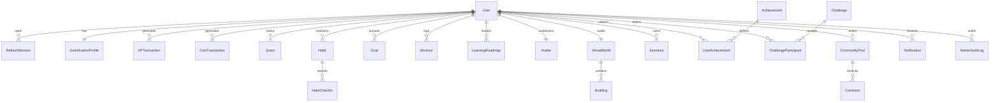

# LIFEVERSE — Database Architecture & Schema Specification

## 1. Database Overview

**LIFEVERSE** utilizes MongoDB as its primary persistent document store, managed through Mongoose ODM. The database architecture is built around transactional integrity for gamification balances, rapid read performance via compound indexes, and automatic session cleanup using Time-To-Live (TTL) indexes.

- **Engine:** MongoDB 6.0+ / 7.0+
- **Default Database:** `lifeverse`
- **Port:** Configured via `MONGODB_URI` (default: `mongodb://127.0.0.1:27018/lifeverse`)



---

## 2. Core Collections & Schema Details

### 2.1 Identity & Authentication

#### `users`
Represents platform accounts across guest, user, and admin roles.
```javascript
{
  username: { type: String, required: true, unique: true, index: true },
  email: { type: String, required: true, unique: true, lowercase: true, index: true },
  passwordHash: { type: String, required: true },
  role: { type: String, enum: ['guest', 'user', 'admin'], default: 'user', index: true },
  isVerified: { type: Boolean, default: false },
  status: { type: String, enum: ['active', 'suspended', 'banned'], default: 'active' },
  avatarUrl: { type: String },
  timezone: { type: String, default: 'UTC' },
  preferences: {
    theme: { type: String, enum: ['dark', 'light'], default: 'dark' },
    notifications: { email: Boolean, push: Boolean, inApp: Boolean }
  },
  createdAt: { type: Date, default: Date.now },
  updatedAt: { type: Date, default: Date.now }
}
```

#### `refresh_sessions` (TTL Managed)
Secures multi-device JWT authentication with token rotation and reuse detection.
```javascript
{
  userId: { type: ObjectId, ref: 'User', required: true, index: true },
  tokenHash: { type: String, required: true, unique: true },
  familyId: { type: String, required: true, index: true },
  userAgent: { type: String },
  ipAddress: { type: String },
  isRevoked: { type: Boolean, default: false },
  expiresAt: { type: Date, required: true, index: { expires: 0 } } // MongoDB TTL index
}
```

---

### 2.2 Server-Authoritative Gamification

#### `gamification_profiles`
The primary single-source-of-truth for user progress, rank, and balances.
```javascript
{
  userId: { type: ObjectId, ref: 'User', required: true, unique: true, index: true },
  totalXp: { type: Number, default: 0, min: 0 },
  level: { type: Number, default: 1, min: 1 },
  currentLevelXp: { type: Number, default: 0 },
  xpToNextLevel: { type: Number, default: 100 },
  coins: { type: Number, default: 50, min: 0 },
  rank: { 
    type: String, 
    enum: ['Novice', 'Explorer', 'Warrior', 'Master', 'Legend'], 
    default: 'Novice' 
  },
  stats: {
    questsCompleted: { type: Number, default: 0 },
    habitsCompleted: { type: Number, default: 0 },
    workoutsLogged: { type: Number, default: 0 },
    learningHours: { type: Number, default: 0 },
    currentStreak: { type: Number, default: 0 },
    longestStreak: { type: Number, default: 0 }
  },
  updatedAt: { type: Date, default: Date.now }
}
```

#### `xp_transactions` & `coin_transactions`
Auditable double-entry ledger ensuring idempotent reward grants.
```javascript
{
  userId: { type: ObjectId, ref: 'User', required: true, index: true },
  amount: { type: Number, required: true },
  type: { type: String, enum: ['QUEST', 'HABIT', 'WORKOUT', 'LEARNING', 'CHALLENGE', 'PURCHASE', 'BONUS'], required: true },
  category: { type: String },
  description: { type: String, required: true },
  idempotencyKey: { type: String, required: true, unique: true, index: true },
  balanceAfter: { type: Number, required: true },
  metadata: { type: mongoose.Schema.Types.Mixed },
  createdAt: { type: Date, default: Date.now }
}
```

---

### 2.3 Productivity, Habits & Missions

#### `quests`
Quests are real-life tasks organized as Kanban or List items with associated difficulty.
```javascript
{
  userId: { type: ObjectId, ref: 'User', required: true, index: true },
  title: { type: String, required: true },
  description: { type: String },
  category: { type: String, enum: ['fitness', 'learning', 'work', 'wellness', 'general'], default: 'general' },
  priority: { type: String, enum: ['low', 'medium', 'high', 'urgent'], default: 'medium' },
  difficulty: { type: String, enum: ['easy', 'medium', 'hard', 'epic'], default: 'medium' },
  xpReward: { type: Number, default: 50 },
  coinReward: { type: Number, default: 10 },
  status: { type: String, enum: ['pending', 'in_progress', 'completed', 'failed'], default: 'pending', index: true },
  dueDate: { type: Date },
  completedAt: { type: Date },
  tags: [{ type: String }]
}
```

#### `habits` & `habit_checkins`
Tracks routine habits with streak maintenance and completion histories.
```javascript
// Habit Model
{
  userId: { type: ObjectId, ref: 'User', required: true, index: true },
  title: { type: String, required: true },
  frequency: { type: String, enum: ['daily', 'weekly'], default: 'daily' },
  targetPerPeriod: { type: Number, default: 1 },
  currentStreak: { type: Number, default: 0 },
  longestStreak: { type: Number, default: 0 },
  lastCheckedIn: { type: Date },
  xpPerCheckIn: { type: Number, default: 25 },
  coinsPerCheckIn: { type: Number, default: 5 },
  color: { type: String, default: '#8B5CF6' }
}

// HabitCheckIn Model
{
  habitId: { type: ObjectId, ref: 'Habit', required: true, index: true },
  userId: { type: ObjectId, ref: 'User', required: true, index: true },
  date: { type: String, required: true }, // Format: YYYY-MM-DD for date-based unique indexing
  createdAt: { type: Date, default: Date.now }
}
// Compound unique index: { habitId: 1, date: 1 } ensures one checkin per calendar day
```

---

### 2.4 Virtual Worlds, 3D Assets & Economy

#### `virtual_worlds` & `buildings`
Stores the isometric / 3D floating island topology, unlocked structures, and upgrades.
```javascript
// VirtualWorld Model
{
  userId: { type: ObjectId, ref: 'User', required: true, unique: true, index: true },
  islandName: { type: String, default: "Genesis Realm" },
  theme: { type: String, enum: ['floating_islands', 'cyber_city', 'mystic_forest'], default: 'floating_islands' },
  gridSize: { type: Number, default: 16 }, // 16x16 grid coordinates
  buildings: [{
    buildingId: { type: ObjectId, ref: 'Building' },
    position: { x: Number, y: Number, z: Number },
    level: { type: Number, default: 1 },
    placedAt: { type: Date, default: Date.now }
  }],
  environmentalEffects: [{ type: String }]
}

// Building Catalog Model
{
  name: { type: String, required: true },
  type: { type: String, enum: ['house', 'library', 'gym', 'tech_center', 'citadel', 'garden', 'portal'] },
  category: { type: String },
  costCoins: { type: Number, required: true },
  requiredLevel: { type: Number, default: 1 },
  xpBonusRate: { type: Number, default: 0.05 },
  assetModelUrl: { type: String },
  icon: { type: String }
}
```

---

## 3. Indexes & Performance Optimization

| Collection | Indexed Fields | Type | Purpose |
|:---|:---|:---|:---|
| `users` | `email`, `username` | Unique | Login lookup & identity prevention |
| `refresh_sessions` | `expiresAt` | TTL (0s) | Automated expiration of stale tokens |
| `refresh_sessions` | `tokenHash`, `familyId` | Unique / Hash | Fast validation and replay detection |
| `xp_transactions` | `idempotencyKey` | Unique | Zero-duplicate reward guarantees |
| `coin_transactions` | `idempotencyKey` | Unique | Financial ledger integrity |
| `habit_checkins` | `{ habitId: 1, date: 1 }` | Compound Unique | Prevents multiple daily streak increments |
| `quests` | `{ userId: 1, status: 1, dueDate: 1 }` | Compound | Fast Kanban & timeline filtering |
| `notifications` | `{ userId: 1, read: 1, createdAt: -1 }`| Compound | Fast notification drawer loading |
| `admin_audit_logs` | `{ createdAt: -1, action: 1 }` | Compound | Rapid audit filtering by timestamp |
