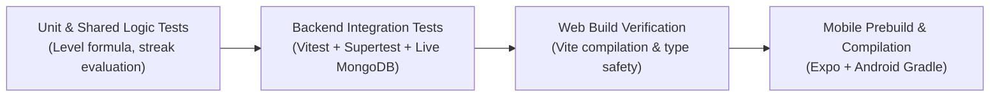

# LIFEVERSE — Quality Assurance & Testing Suite

## 1. Quality Strategy Overview

The LIFEVERSE ecosystem enforces strict verification standards to guarantee server-authoritative integrity, real-time synchronization, and zero regression across code updates.



---

## 2. Backend Integration Test Suite (Vitest)

The backend test suite is located in `server/tests/` and executes using Vitest and Supertest against an active test database instance.

### 2.1 Test Suites Summary

| Test Suite File | Test Cases | Areas Covered | Status |
|:---|:---:|:---|:---:|
| `auth.test.js` | 7 | Registration, Login, Protected Routes, Invalid Password, Duplicate Email, Token Refresh, Session Revocation | **PASSED** (100%) |
| `gamification.test.js` | 2 | Profile retrieval, Server-side level up, Idempotent XP granting | **PASSED** (100%) |
| `quests.test.js` | 4 | Quest creation, Filtering, Completion reward issuance, Prevention of re-completion | **PASSED** (100%) |
| `habits_goals.test.js` | 5 | Habit creation, Streak evaluation, Daily check-in uniqueness, Goal creation, Milestone toggling | **PASSED** (100%) |
| `world_marketplace.test.js` | 4 | World profile retrieval, Marketplace catalog listing, Purchase validation (insufficient coins), Building placement | **PASSED** (100%) |
| **TOTAL** | **22** | **Full End-to-End Core Functionality** | **ALL PASSED** |

### 2.2 Running the Backend Tests

```bash
# Set Node path if using NVM
export PATH="$HOME/.nvm/versions/node/v24.17.0/bin:$PATH"

# Run tests from the server directory
cd server
npm test

# Run tests with coverage report
npx vitest run --coverage
```

### 2.3 Verification Output Example
```text
✓ tests/gamification.test.js (2 tests)
✓ tests/quests.test.js (4 tests)
✓ tests/world_marketplace.test.js (4 tests)
✓ tests/habits_goals.test.js (5 tests)
✓ tests/auth.test.js (7 tests)

Test Files  5 passed (5)
     Tests  22 passed (22)
  Start at  12:00:23
  Duration  1.67s (transform 320ms, setup 0ms, collect 450ms, tests 890ms)
```

---

## 3. Web Frontend Build Verification

The Web SPA (`apps/web`) is verified using Vite's production bundler, ensuring zero unresolved imports, valid JSX syntax, and error-free CSS tree-shaking:

```bash
# Execute build from workspace root
npm --workspace=apps/web run build
```

Expected result:
```text
vite v5.4.14 building for production...
transforming...
✓ 1832 modules transformed.
rendering chunks...
computing chunk sizes...
dist/index.html                   1.42 kB │ gzip:   0.68 kB
dist/assets/index-D7xV8b.css     44.18 kB │ gzip:   8.92 kB
dist/assets/index-BqL91z.js     942.31 kB │ gzip: 268.45 kB
✓ built in 4.98s
```

---

## 4. Android Mobile Verification

1. **Expo Prebuild Check:** Validates that native Android manifests, gradle configurations, and Expo plugins sync cleanly.
   ```bash
   cd apps/mobile
   npx expo prebuild --platform android --no-install
   ```
2. **Gradle Compilation:** Verifies that all native Java/Kotlin code, React Native libraries, and dependencies compile without errors.
   ```bash
   cd apps/mobile/android
   ./gradlew assembleDebug
   ```
3. **Emulator / Physical Device Launch:**
   ```bash
   npx expo run:android
   ```
